# PixAI Illustrator Bridge 0.2.0 사용 설명서

Marinara Engine에서 PixAI로 그림을 만들어 주는 확장의 **사용자용 설명서**입니다. 개발 지식 없이 읽을 수 있게 썼습니다. 버튼·체크박스 이름은 화면에 보이는 그대로 **굵게** 적었습니다.

> **이 설명서의 GitHub 설치 절차는 0.2.0의 정식 Latest 승격 후를 기준으로 합니다.** 이 문서 자체가 승격 완료를 뜻하지는 않습니다. 설치 화면의 버전이 0.2.0인지 확인하세요. 진단 경로의 실기기 생성·다운로드 성공은 보고됐지만, 갤러리·셀피·자동 삽화의 실기기 확인은 남아 있습니다.

> **그림을 읽는 법:** 번호 그림은 Engine 2.4.6의 격리 QA에서 합성 성인 캐릭터·가짜 키로 촬영했습니다. 모바일 그림은 Chromium 390px 에뮬레이션이며 iPhone Safari 실기기 검증이 아닙니다. `real-` 그림은 제공받은 실사용 화면입니다. 유료 확인창은 촬영 후 **취소**했고, 자동 삽화 완성 화면은 과금하지 않기 위해 싣지 않았습니다.

> ⚠️ **가장 많이 막히는 곳 — 먼저 읽으세요**
>
> **무료 미리보기**를 누르기 전에 반드시 **캐릭터·페르소나 프로필**(접혀 있는 제목)을 펼쳐 **현재 채팅 프로필 읽기**를 먼저 누르세요. 그 전에는 **무료 셀피 미리보기 대상** 칸이 **비어 있고**, 미리보기를 누르면 이유 없이 `미리보기 실패 — 처리 실패`만 나옵니다. 실제 사용자도 이 상태에서 막혔습니다(아래 그림). 0.2.1에서 안내 문구를 고칠 예정입니다.
>
> 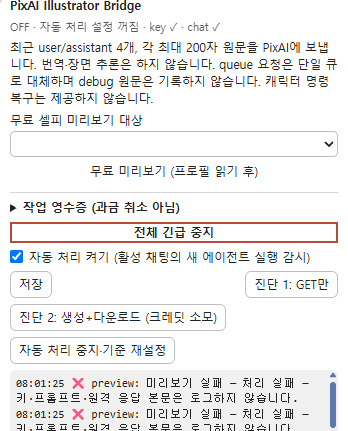
> *실제 화면: 대상 칸이 비어 있고, 로그에 `preview: 미리보기 실패 — 처리 실패 …`가 찍혔습니다.*

---

## 목차

1. 이 확장이 하는 일과 비용
2. 준비물
3. 설치·업데이트·삭제
4. 처음 설정하는 순서
5. 패널 전체 둘러보기
6. 로그 읽는 법
7. 비용과 안전
8. 문제 해결 (FAQ)
9. 알려진 제한

---

## 1. 이 확장이 하는 일과 비용

PixAI 공식 API에 **이미지 1장**을 요청하고, 받은 그림을 Marinara **갤러리**에 저장합니다.

| 기능 | 무엇을 하나 | 필요한 것 |
|---|---|---|
| **자동 삽화** | 채팅에 붙인 **PixAI Director** 에이전트가 답장마다 "그릴 만한 장면인지" 판단해 태그를 쓰면, 확장이 그 태그로 그림을 만들어 **그 답장 메시지에 첨부**하고 갤러리에도 저장합니다. 그릴 게 없으면 Director가 `SKIP`을 내고 아무것도 안 합니다. | 확장 + Director 에이전트(JSON) + 채팅에서 Agent 켜기 |
| **셀피 대체** | Marinara의 Conversation 모드 셀피 요청을 PixAI로 대신 처리합니다. 결과는 **갤러리에만** 저장되고 메시지에는 붙지 않습니다. | 확장만(Director 불필요) |
| **무료 미리보기** | PixAI에 보낼 셀피 프롬프트를 **보내지 않고** 미리 보여 줍니다. | 확장 + 열린 채팅 |
| **진단 1 / 진단 2** | PixAI에 닿는지(1), 실제로 그림 1장이 만들어지는지(2) 확인합니다. | 확장 + 저장된 키 |
| **캐릭터·페르소나 프로필** | 캐릭터마다 고정 외모 태그·별칭·전용 LoRA를 저장해 매번 같은 외모로 그리게 합니다. | 확장 |

### 버튼별 비용 (PixAI 크레딧)

| 버튼/동작 | 크레딧 | 확인창 |
|---|---|---|
| **무료 미리보기 (프로필 읽기 후)** | 없음 — PixAI에 아무 요청도 보내지 않음 | 없음 |
| **현재 채팅 프로필 읽기**, 각종 저장 버튼 | 없음 | 없음 |
| **진단 1: GET만** | 없음 — 생성 요청을 보내지 않음(조회 요청 1회만) | 없음 |
| **진단 2: 생성+다운로드 (크레딧 소모)** | **듦** — 누를 때마다 1장 | "이미지 1장 생성으로 PixAI 크레딧을 소모합니다. 계속할까요?" |
| **셀피 대체** ON 상태의 셀피 요청 | **듦** — 요청마다 1장 | "셀피 이미지 1장을 생성하며 PixAI 크레딧을 소모합니다. 완료 후 재요청도 추가 비용입니다. 계속할까요?" |
| **자동 삽화** (자동 처리 ON) | **듦** — Director가 장면을 쓸 때마다 1장 | **없음 — 확인창 없이 자동으로 과금됩니다** |

- 한 번 완료된 뒤 **다시 누르면 새 비용**입니다.
- 실제 장당 비용은 모델·mode·size·LoRA와 PixAI 계정 정책에 따라 다릅니다. 이 확장은 비용을 계산하지 않습니다.
- Director 에이전트 자체는 그림을 만들지 않지만, 채팅에서 돌 때마다 **선택한 AI 연결(LLM)** 요청이 한 번씩 생깁니다. 그 비용은 PixAI와 별개입니다.

---

## 2. 준비물

### 2-1. PixAI API 키

- PixAI 개발자 플랫폼(`platform.pixai.art`)에서 API 키를 발급받습니다. 메뉴 위치는 PixAI 화면을 따르세요.
- 키는 **비밀번호와 같습니다.** 남에게 보내거나 스크린샷에 찍히게 하지 마세요. 키가 있으면 누구나 내 크레딧으로 그림을 만들 수 있습니다.
- 이 확장은 키를 **Marinara 서버의 확장 저장소에 암호화 없이(평문)** 저장합니다(7장 참고).

### 2-2. Marinara 설정 (Danger Zone)

| 설정 | 언제 필요 | 위치 |
|---|---|---|
| **Allow third-party extension imports** | 항상 (확장 ZIP 가져오기) | Settings › Advanced › Danger Zone |
| **Allow custom Agent imports** | 자동 삽화를 쓸 때만 (Director JSON 가져오기) | Settings › Advanced › Danger Zone |

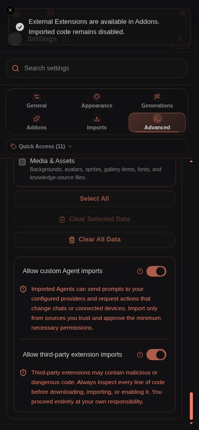
*Allow third-party extension imports를 켭니다.*

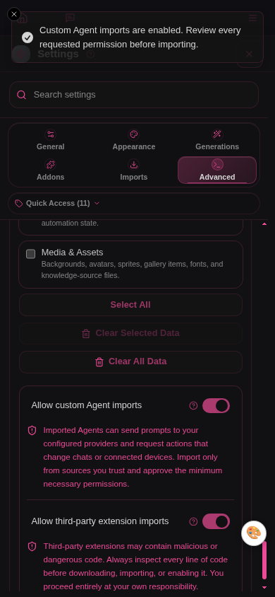
*자동 삽화를 쓸 때만 Allow custom Agent imports도 켭니다. 다시 끄면 가져온 Agent도 실행되지 않습니다.*

두 설정 모두 외부 코드를 실행하게 허용하는 보안 설정입니다. 내용을 확인하고 켜세요. **Allow third-party extension imports가 잠겨 있으면 서버 운영자가 `ENABLE_EXTERNAL_EXTENSIONS=true`를 설정해야 합니다.** 브라우저 토글만으로 이 서버 제한을 해제할 수 없습니다. 모바일에서는 상단 **More › Settings**로 들어갑니다.

### 2-3. 파일 두 개 — 넣는 곳이 다릅니다

| 파일 | 넣는 곳 | 필요할 때 |
|---|---|---|
| `marinara-pixai-illustrator-v0.2.0.zip` | Settings › Addons › External Extensions › Import (**ZIP 그대로**, 압축 풀지 않기) | 항상 |
| `pixai-director.agent.json` | Agents › **Import agents** | 자동 삽화를 쓸 때만 |

- JSON을 External Extensions에 넣거나 ZIP을 Agents에 넣지 마세요.
- **JSON을 두 번 가져오지 마세요.** 다시 가져오면 기존 Director가 갱신되는 게 아니라 **새 Director가 하나 더** 생깁니다. Director가 2개 이상이면 자동 삽화가 켜지지 않습니다(8장 FAQ). 셀피에는 Director가 필요 없습니다.

### 2-4. 브라우저 조건

- **localhost 또는 HTTPS 주소**로 접속한 브라우저에서 쓰세요. 이 확장은 브라우저의 Web Locks 기능이 있어야 유료 작업을 실행합니다. 일반 HTTP 원격 주소에서는 막힙니다.
- **한 기기·한 브라우저·한 주소에서만** 쓰세요. PC와 iPhone에서 동시에 열어 두면 서로를 알아보지 못해 **같은 장면을 두 번 과금**할 수 있습니다.
- 0.1.x 버전이 열린 탭은 모두 닫으세요.

---

## 3. 설치·업데이트·삭제

### 3-1. ZIP으로 설치 (기본 방법)

1. 열려 있는 Marinara 탭 중 이전 버전 확장이 돌던 탭을 모두 닫습니다.
2. Settings › Advanced › Danger Zone에서 **Allow third-party extension imports**를 켭니다.
3. Settings › Addons › External Extensions › **Import Extension File**을 누르고 `marinara-pixai-illustrator-v0.2.0.zip`을 선택합니다.
   - **iPhone:** 파일 앱에 받은 `.zip`을 그대로 고르세요. 파일 앱에서 ZIP을 눌러 압축이 풀린 폴더가 생겼다면 그 폴더가 아니라 원래 `.zip` 파일을 고릅니다.
4. 가져온 항목을 열어 권한(**Full page access**, `full_page_access`)과 코드를 확인합니다. **Enable** → **Run Code With Full Page Access?**에서 **Run Exact Code**로 정확한 해시를 승인하고 페이지를 새로고침합니다. 가져오기만 하면 비활성 초안이며, 승인 전에는 실행되지 않습니다.
5. 화면 구석에 **🎨** 동그란 버튼이 생기면 설치 완료입니다.

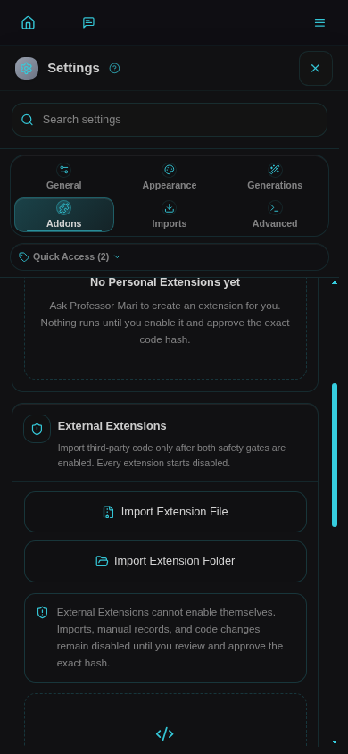
***Import Extension File**을 누르고 ZIP을 압축 풀지 않은 채로 고릅니다. OS 파일 선택창은 이 그림에 포함하지 않았습니다.*

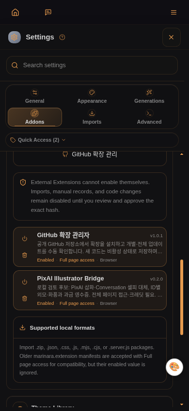
*`PixAI Illustrator Bridge` 0.2.0이 목록에 보이고 활성 상태여야 합니다.*

### 3-2. Director 에이전트 가져오기 (자동 삽화를 쓸 때만)

1. Settings › Advanced › Danger Zone › **Allow custom Agent imports**를 켭니다.
2. **Agents** 패널의 **Import agents**를 누릅니다. **Download Agents**는 별도 라이브러리입니다.
3. 가져오기 창에서 **Choose Files**를 누르고 `pixai-director.agent.json`을 선택합니다. **Choose Folder**나 **Game Mode ruleset**은 고르지 않습니다.
4. **Review Agent Import Permissions** 화면에서 이름 `PixAI Director`, phase `post_processing`, 그리고 "This Agent does not request any privileged capabilities."가 보이는지 확인합니다.
5. **Approve Permissions and Import**를 누릅니다.
6. **Custom Agents › PixAI Director**를 열어 Pipeline Phase: Post-Processing, Result Type: Context Injection, Custom Agent Abilities 모두 OFF, Add as Prompt Section OFF인지 확인합니다. Tools / Function Calling에서 도구를 고르지 마세요.
7. 그림을 넣고 싶은 채팅에서 **Chat Settings › Agents › Custom Agents**를 펼쳐 `PixAI Director`를 고릅니다. **Add PixAI Director** 창에서 예산·주기를 확인한 뒤 **Add**를 누릅니다. QA의 Conversation 화면에서는 이 동작으로 Agent 사용이 함께 켜졌으며, 별도 **Enable Agents** 토글은 없었습니다. 다른 모드·버전에 해당 토글이 보이면 켭니다. 가져오기만 해서는 채팅에 붙지 않습니다.

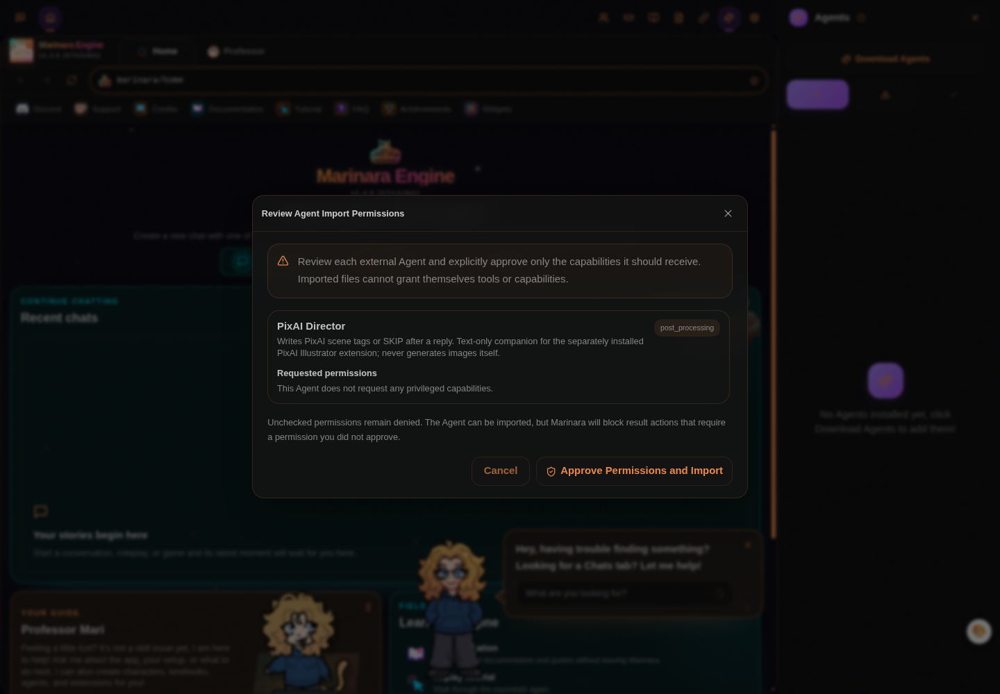
*특권 권한을 요청하지 않는다는 문구가 보여야 합니다.*

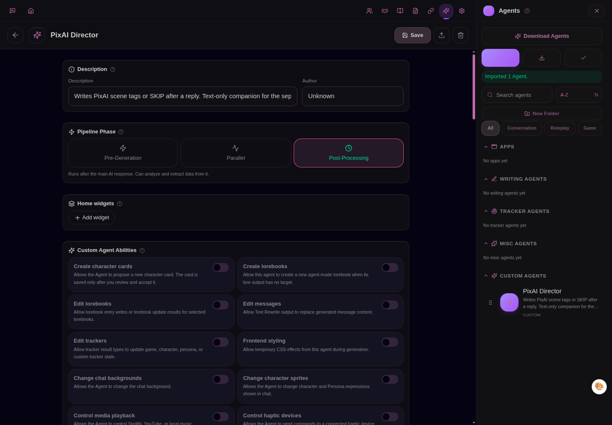
*위 그림은 Post-Processing과 능력 설정의 윗부분입니다. 아래로 스크롤해 Result Type: Context Injection, Add as Prompt Section: Disabled, Tools 0개도 확인하세요.*

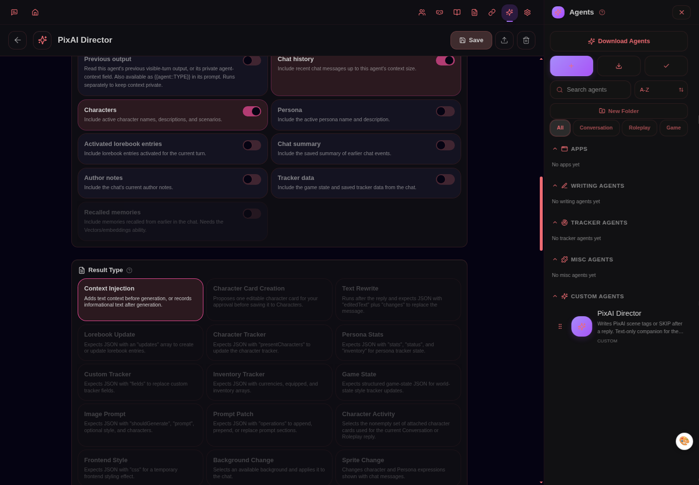
*Result Type은 Context Injection입니다.*

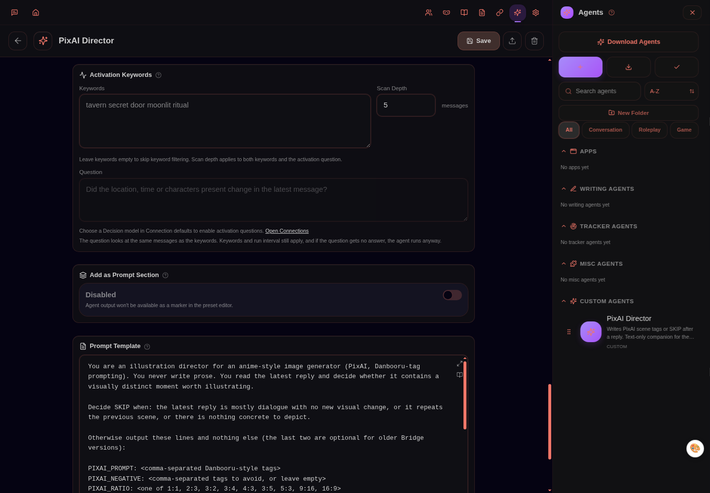
*Add as Prompt Section은 Disabled, Tools / Function Calling은 0개입니다.*

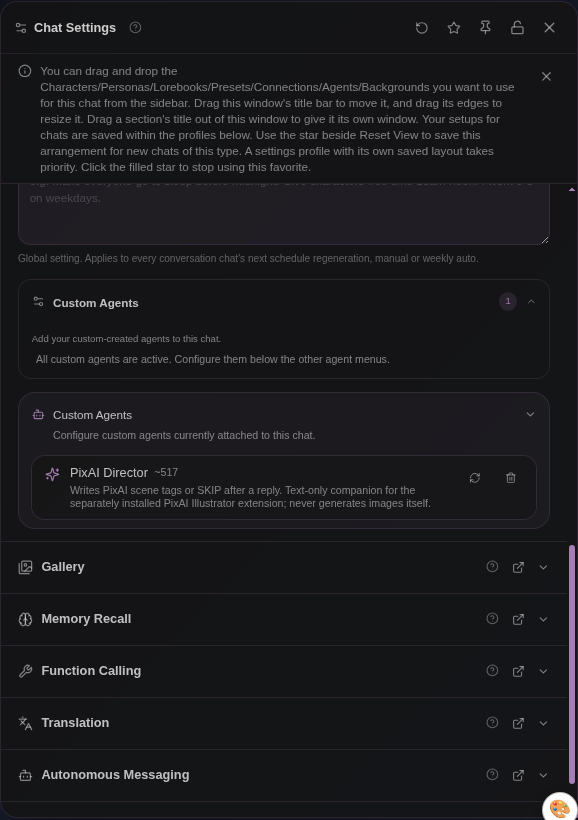
*Director는 이렇게 추가한 채팅에서만 돕니다.*

### 3-3. GitHub 주소로 설치·업데이트 (0.2.0 Latest 승격 후 기준)

> 관리자 1.0.1의 실제 주소 검색·설치·업데이트 경로는 QA에서 확인했습니다. **0.2.0 Latest 승격 후의 첫 선택지 자체는 아직 확인 중**입니다. 승격 전 상태를 승격 후 화면처럼 바꾸어 싣지 않았습니다.

커뮤니티 제3자 확장인 **GitHub 확장 관리자**(README 기준 1.0.1)를 따로 가져와 승인해 둔 경우에 쓸 수 있습니다. 이 저장소에 포함되어 있지 않고 자동 설치되지도 않습니다.

1. Settings › Addons › External Extensions의 **GitHub 확장 관리**를 열고 `https://github.com/mallang0723/marinara-pixai-illustrator`를 입력한 뒤 **패키지 찾기**를 누릅니다.
2. **설치 대상을 반드시 확인하세요.** 0.2.0이 Latest로 승격된 뒤에는 정식 Release인 `v0.2.0 / marinara-pixai-illustrator-v0.2.0.zip`을 선택합니다. 아직 0.2.0 Release ZIP이 보이지 않으면 진행하지 말고 승격을 기다리거나 3-1의 배포 ZIP 설치를 이용하세요.
3. **내용 확인**에서 버전·권한·코드를 보고 설치합니다. 새 코드는 **비활성**으로 저장됩니다. Marinara 기본 External Extensions 화면에서 승인하고 새로고침해야 🎨 버튼이 생깁니다.
4. 이미 ZIP으로 설치한 상태라면 새로 설치하지 말고 같은 이름 항목에서 **GitHub 주소 연결** → 패키지 선택 → **이 저장소 연결**을 씁니다. 연결만으로는 코드가 바뀌지 않습니다.
5. 이후 업데이트는 **업데이트 확인** → **업데이트 보기** → **업데이트 설치**. **업데이트가 들어오면 확장이 다시 비활성화**되므로, Marinara에서 다시 승인하고 새로고침해야 합니다. 설정과 저장 키는 유지됩니다.
6. Release ZIP 경로로 연결했다면 다음 Release의 파일명이 바뀔 때 업데이트 확인이 건너뛰어질 수 있습니다. 그때는 **주소 변경**으로 새 ZIP을 다시 고릅니다.

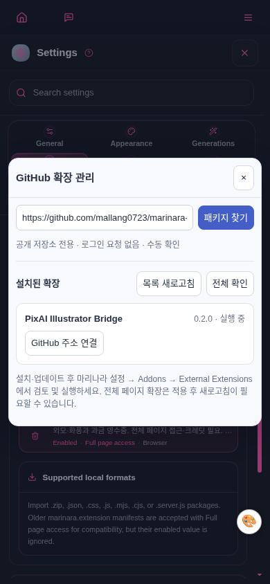
*실제 관리자에 저장소 주소를 입력한 화면입니다. 미래의 Latest 선택지를 합성하지 않았습니다.*

### 3-4. 업데이트 (ZIP)

1. 패널에서 **전체 긴급 중지**를 누르고 **작업 영수증**에 진행 중 작업이 없는지 봅니다. **과금 중에는 업데이트하지 마세요.**
2. **Import Extension File**로 새 ZIP을 가져오면 같은 이름 설치본에 **Update Personal Extension?** 확인창이 뜹니다. **Save Disabled Update**로 교체합니다. QA에서 동일 v0.2.0 ZIP은 **같은 확장 ID 1개**를 유지했습니다(Director JSON 재가져오기와 다름). 코드 해시가 바뀌면 다시 승인하고 새로고침합니다. **완전히 같은 ZIP/해시의 재가져오기는 기존 활성 상태를 유지**했습니다. 변경 코드 업데이트와 혼동하지 마세요.
3. 패널에서 설정이 남아 있는지 확인하고, 필요한 기능을 다시 켭니다(긴급 중지로 꺼졌기 때문).

0.1.x에서 올라오면 기존 모델·위치·자동 처리 ON/OFF는 유지되고, 새 옵션(셀피 대체·페르소나·최근 대화)은 **OFF**로 시작합니다.

### 3-5. 끄기·삭제·되돌리기

1. **전체 긴급 중지**를 누르고 작업 영수증을 확인합니다.
2. 키를 서버에서 지우려면 **저장된 키 삭제**를 누릅니다. **확장을 비활성화하거나 삭제해도 서버에 저장된 키는 남습니다.** 꼭 먼저 지우세요.
3. Director를 비활성화하고 필요하면 Agents에서 삭제합니다.
4. Marinara External Extensions에서 확장을 비활성화하거나 삭제합니다.
5. 갤러리 그림·메시지 첨부·서버 백업·PixAI 계정의 자료는 **따로** 지워야 합니다. 확장을 지워도 남습니다.
6. 0.1.4로 되돌릴 때: 모든 기능 OFF → 모든 탭 닫기 → 0.1.4 설치. 키 백업 파일은 만들지 마세요.

---

## 4. 처음 설정하는 순서

**권장 순서를 꼭 지키세요.** 특히 5번(프로필 읽기)을 건너뛰면 6번이 실패합니다.

> ⚠️ **자동 처리(아래 8번)를 켜기 전에:** 자동 삽화는 **확인창 없이 새 장면마다 크레딧을 사용**합니다. 체크만으로는 켜지지 않으며 **저장까지 눌러야** 켜집니다. 비용을 원치 않으면 저장하지 마세요.

| 순서 | 할 일 | 비용 |
|---|---|---|
| 1 | 테스트용 채팅을 하나 엽니다(합성 성인 캐릭터 권장). 🎨을 눌러 패널을 엽니다. | 무료 |
| 2 | **API key** 칸에 키를 붙여 넣고 **API 키 기억**이 체크된 채로 **저장**을 누릅니다. 로그에 `settings: saved (key set; auto=false)`가 떠야 합니다. | 무료 |
| 3 | **진단 1: GET만**을 누릅니다. `pixai.preflight GET ✅ HTTP 400 …`이면 정상입니다(6장). | 무료 |
| 4 | 모델·LoRA·비율 등을 고르고 **저장**. 화풍을 쓰면 **화풍·PixAI style**을 펼쳐 **화풍 설정 저장**. | 무료 |
| 5 | **캐릭터·페르소나 프로필**(접힌 제목)을 눌러 펼친 뒤 **현재 채팅 프로필 읽기**를 누릅니다. 캐릭터 카드가 나타나고 **무료 셀피 미리보기 대상** 칸이 채워집니다. 필요하면 고정 외모 태그 등을 넣고 **이 캐릭터 프로필 저장**. | 무료 |
| 6 | **무료 셀피 미리보기 대상**에서 캐릭터를 고르고 **무료 미리보기 (프로필 읽기 후)**를 누릅니다. 아래 상자에 실제로 보낼 prompt가 나옵니다. | 무료 |
| 7 | (비용 승인 후) **진단 2**로 실제 1장이 만들어지는지 확인합니다. | **유료** |
| 8 | (비용 승인 후) 쓰고 싶은 기능만 켭니다: **셀피 대체** 체크(즉시 저장) 또는 **자동 처리 켜기** 체크 + **저장**. | 사용할 때마다 **유료** |

> ⚠️ **8번을 실행하기 전:** 자동 삽화는 **비용 확인창 없이** Director의 새 장면마다 바로 PixAI 크레딧을 사용합니다. 확인창이 뜨는 것은 **진단 2·셀피 생성**입니다. 자동 처리는 체크한 뒤 **저장**까지 눌러야 켜집니다. 원치 않으면 저장하지 마세요.

주의:

- **2번에서 키만 입력하고 저장을 안 누르면** 진단 1은 `diag: 키 입력 필요`로 끝납니다. 키는 **저장**을 눌러야 적용됩니다.
- **8번의 자동 처리 켜기는 체크만 해서는 켜지지 않습니다.** 반드시 **저장**까지 눌러야 합니다. 저장 전 상태줄 예: `OFF · 자동 처리 설정 꺼짐 · key ✓ · chat ✓`. 켠 뒤에는 `ON · key ✓ · chat ✓`인지 확인하세요. **작업 중에는 저장이 막히므로 급히 끄려면 중지 버튼**을 쓰세요.

---

## 5. 패널 전체 둘러보기

### 5-1. 🎨 버튼과 머리줄

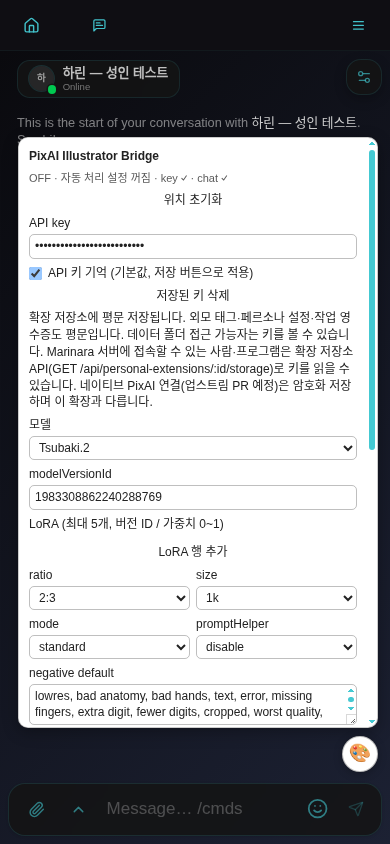
*상태줄은 4초마다 새로 그려집니다.*

- **🎨 버튼**: 누르면 패널이 열리고 닫힙니다. 끌어서 옮길 수 있습니다(6px 미만 움직임은 탭으로 처리). 위치는 저장됩니다.
- **패널 제목 줄**(`PixAI Illustrator Bridge`): 끌어서 패널을 옮깁니다.
- **위치 초기화**: 버튼·패널 위치를 기본값(화면 오른쪽 아래)으로 되돌립니다.
- **상태줄**: `ON · key ✓ · chat ✓` 또는 `OFF · <이유> · key ✓/✗ · chat ✓/✗`. **자동 삽화**의 상태만 뜻합니다(셀피 대체 ON/OFF와는 무관).

| 상태줄 이유 | 뜻 | 할 일 |
|---|---|---|
| `자동 처리 설정 꺼짐` | 자동 처리가 저장된 상태로 꺼져 있음 | 켜려면 **자동 처리 켜기** 체크 + **저장** |
| `API 키 입력·저장 필요` | 메모리에 키가 없음 | 키 입력 후 **저장** |
| `다른 탭 실행 중 또는 Web Locks 대기·미지원` | 다른 탭이 실행 탭이거나, HTTP 주소라 Web Locks가 없음 | 다른 Marinara 탭 닫기, localhost/HTTPS로 접속 |
| `PixAI Director 확인 필요 — 한 개 가져온 뒤 저장` | Director를 아직 확인하지 못함 | Director 1개만 남기고 **저장** |
| `활성 채팅 없음` | 열린 채팅이 없음 | 채팅을 엽니다 |
| `확장 중지` | 확장이 비활성화/정리됨 | 확장을 다시 켜고 새로고침 |
| `저장소 이행/버전 오류 또는 Web Locks 미지원 — 유료 실행 차단` | 저장소 형식 문제 또는 브라우저 미지원 | 구버전 탭 닫기, localhost/HTTPS 확인 |
| `key ✗` / `chat ✗` | 키 없음 / 열린 채팅 없음 | — |

**실행 탭:** 같은 브라우저에서 Marinara 탭을 여러 개 열면 **한 탭만** 유료 작업을 실행합니다. 다른 탭에서는 설정 저장이 막히고 `설정은 실행 탭에서 저장하세요. OFF·긴급 중지·키 삭제는 모든 탭에서 가능합니다.`가 뜹니다. 끄기·긴급 중지·키 삭제는 어느 탭에서나 됩니다.

### 5-2. API 키

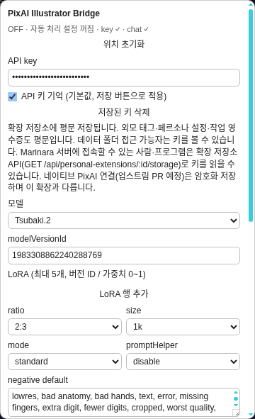
*키는 점으로 가려진 채 보여야 합니다.*

| 항목 | 설명 |
|---|---|
| **API key** | PixAI 키 입력칸. **저장**을 눌러야 적용됩니다. |
| **API 키 기억 (기본값, 저장 버튼으로 적용)** | ON(기본): 저장 시 키를 서버 확장 저장소에 평문 저장하고 다음에 자동 입력. OFF + **저장**: 서버의 키를 비우고 지금 열린 화면 메모리에만 둡니다(새로고침하면 다시 입력). |
| **저장된 키 삭제** | 키를 메모리·입력칸·서버에서 지우고 **API 키 기억**을 끕니다. **동시에 전체 긴급 중지와 같은 동작**을 합니다(자동 처리·셀피 대체 OFF, 진행 중 후처리 중단, 다른 탭에도 알림). 로그는 `stop: 전체 중지됨 …`로 찍힙니다. |
| 경고문 | 키·외모 태그·페르소나 설정·작업 영수증이 서버에 평문으로 저장되고, 서버에 접속할 수 있는 사람·프로그램이 읽을 수 있다는 안내입니다. |

### 5-3. 모델과 LoRA

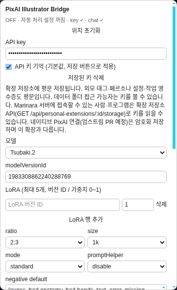
*LoRA 행은 최대 5개.*

| 항목 | 설명 |
|---|---|
| **모델** | 미리 넣은 3개: Tsubaki.2 `1983308862240288769`, Haruka v2 `1861558740588989558`, Hoshino v2 `1954632828118619567`. **직접 입력 (modelVersionId)**을 고르면 아래 칸이 열립니다. |
| **modelVersionId** | 모델의 **버전 ID**(숫자만). pixai.art 모델 페이지 주소의 마지막 숫자입니다. 숫자가 아니면 저장 시 `모델 ID는 양의 정수 문자열이어야 합니다.` |
| **LoRA (최대 5개, 버전 ID / 가중치 0~1)** | **LoRA 행 추가**로 행을 만들고, 왼쪽에 LoRA **버전 ID**(숫자), 오른쪽에 가중치(0~1, 기본 1)를 넣습니다. **삭제**로 행을 지웁니다. |

LoRA 규칙(어기면 **저장**이 거부되고 로그에 이유가 나옵니다):

- 최대 5개(`LoRA는 최대 5개입니다.`), ID는 숫자만(`LoRA ID는 양의 정수 문자열이어야 합니다.`), 가중치는 0~1(`LoRA weight는 0~1이어야 합니다.`), 같은 ID 중복 금지(`LoRA ID가 중복되었습니다.`).
- **빈 행도 오류입니다.** 안 쓰는 행은 **삭제**하세요.
- 캐릭터 프로필의 전용 LoRA와 합쳐서도 **5개를 넘으면 생성 전에 차단**됩니다(`병합 LoRA 5개 초과 — 프로필/전역 행을 수정하세요.`).
- 같은 LoRA ID가 캐릭터 전용과 여기(전역)에 다 있으면 **캐릭터 쪽 가중치가 우선**합니다(미리보기 경고: `캐릭터 LoRA 가중치가 전역 설정보다 우선합니다.`).
- 한 장면에 두 캐릭터가 같은 LoRA를 서로 다른 가중치로 쓰면 차단됩니다(`캐릭터 LoRA 가중치 충돌`).
- LoRA가 베이스 모델과 맞는지는 확장이 확인하지 못합니다. 모델 페이지에서 확인하세요.

### 5-4. 비율·크기·모드·negative

*기본값: 2:3 / 1k / standard / disable.*

| 항목 | 선택지 | 설명 |
|---|---|---|
| **ratio** | 1:1, 2:3, 3:2, 3:4, 4:3, 3:5, 5:3, 9:16, 16:9 | 기본 비율. 자동 삽화는 Director가 `PIXAI_RATIO`를 정하면 그걸 쓰고, 없거나 잘못되면 이 값을 씁니다. 셀피는 이 값, 진단 2는 항상 1:1. |
| **size** | 1k, 1.5k | 이미지 크기 |
| **mode** | (none), lite, standard, pro, ultra | PixAI 생성 모드. **Tsubaki 전용입니다. 다른 모델에서는 `(none)`으로 바꾸세요.** |
| **promptHelper** | disable, enable | PixAI 쪽 프롬프트 보조 기능 사용 여부 |
| **negative default** | 글 | 빼고 싶은 요소(기본값은 저화질·손가락 오류·워터마크 등). 최대 2,000자. **Director가 `PIXAI_NEGATIVE`를 쓰면 이 칸 대신 그것을 씁니다(합치지 않음).** |

이 모든 칸은 **저장** 버튼으로 저장됩니다. 모델·mode·size별 실제 지원 여부와 비용은 PixAI 계정 정책을 따릅니다.

### 5-5. 화풍·PixAI style (접힌 섹션)

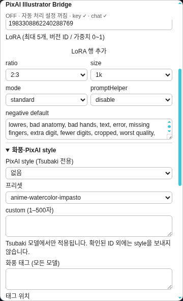
*이 섹션은 자기 저장 버튼(**화풍 설정 저장**)이 따로 있습니다.*

| 항목 | 설명 |
|---|---|
| **PixAI style (Tsubaki 전용)** | 없음 / 프리셋 / custom. PixAI의 공식 style 기능입니다. **Tsubaki.2(`1983308862240288769`)일 때만 PixAI에 보내고**, 다른 모델에서는 선택만 보관하고 보내지 않습니다(미리보기 경고: `확인된 Tsubaki 모델이 아니므로 style은 전송하지 않습니다. 화풍 태그는 유지됩니다.`). |
| **프리셋** | 공식 문서에서 가져온 35개(예: `moe-pastel`, `korean-style`, `pencil-sketch` …). |
| **custom (1–500자)** | 직접 쓰는 style 설명. 이 길이만큼(+2자) 프롬프트 2,000자 예산이 줄어듭니다. |
| **화풍 태그 (모든 모델)** | 쉼표로 구분한 태그. 모든 모델에서 프롬프트에 직접 붙습니다. 잘리지 않고 항상 먼저 자리를 잡습니다. |
| **태그 위치** | 앞 / 뒤 — 화풍 태그를 프롬프트 앞에 붙일지 뒤에 붙일지 |
| **화풍 설정 저장** | 이 섹션만 저장. 성공 시 `style: 화풍 저장됨`. 화풍 태그+고정 외모가 2,000자를 넘거나 custom이 비었거나 500자를 넘으면 `화풍 저장 실패 — …`. |

Director 프롬프트는 화풍·품질 태그를 쓰지 않도록 되어 있으니, 원하는 화풍은 여기서 정하세요.

### 5-6. 캐릭터·페르소나 프로필 (접힌 섹션)

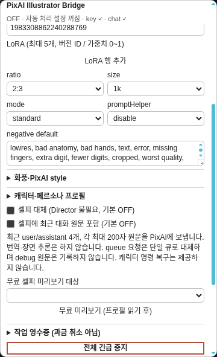
*▶ 제목을 눌러야 **현재 채팅 프로필 읽기** 버튼이 보입니다. iPhone에서는 스크롤해서 찾으세요.*

**현재 채팅 프로필 읽기**: 지금 열린 채팅의 참가 캐릭터를 읽어 캐릭터마다 카드를 만들고, **무료 셀피 미리보기 대상** 칸을 채웁니다. 크레딧은 들지 않습니다(Marinara 서버만 조회). 실패하면 `profiles: 프로필 조회 실패 — 현재 채팅·카드 계약 확인`.

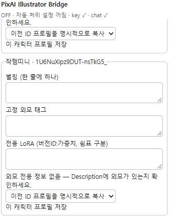
*실제 화면: 카드 제목은 `이름 · 캐릭터ID`. Appearance 칸이 없는 카드라 "외모 전용 정보 없음" 경고가 떴습니다. 맨 아래 "이 캐릭터 프로필 저장"은 글자처럼 보여도 버튼입니다.*

캐릭터 카드 항목:

| 항목 | 설명 |
|---|---|
| **별칭 (한 줄에 하나)** | Director가 캐릭터를 다른 이름으로 부를 때 찾기 위한 이름. 한 줄에 하나, 줄당 200자 이하. |
| **고정 외모 태그** | 매번 반드시 넣을 외모 태그(예: 머리색·눈색·옷). 영어 Danbooru 태그 권장. 잘리지 않는 필수 영역입니다. |
| **전용 LoRA (버전ID:가중치, 쉼표 구분)** | 예: `123456:0.7,789012:0.5`. 이 캐릭터가 등장할 때만 붙습니다. 규칙은 5-3과 같습니다. |
| 상태 문구 | `고정 외모 설정 있음` / `Appearance 있음 — 미리보기에서 확인하세요.` / `외모 전용 정보 없음 — Description에 외모가 있는지 확인하세요.` / `외모 정보 없음 → 카드 Appearance 칸이나 고정 태그를 채우세요.` / 뒤에 `LoRA 설정 있음 / 외모 텍스트 없음`이 붙을 수 있음 |
| **이전 ID 프로필을 명시적으로 복사** | 캐릭터를 다시 가져와서 ID가 바뀌었을 때, 예전 ID의 프로필 내용을 이 카드 칸으로 복사합니다. 복사 후 **이 캐릭터 프로필 저장**을 눌러야 저장됩니다. |
| **이 캐릭터 프로필 저장** | 이 캐릭터만 저장. 성공 시 카드에 `프로필 저장됨 — 무료 미리보기에서 확인하세요.`, 실패 시 `저장 실패 — <이유>`. |

카드 외모를 읽는 순서: 카드의 `extensions.appearance` → `appearance` → (없으면) Description. 읽은 내용은 프롬프트에 `[Appearance: …]` 또는 `[Description: …]` 형태로 **원문 그대로** 들어갈 수 있습니다(번역·요약 없음). 남은 자리에 통째로 들어갈 때만 붙고, 자리가 모자라면 통째로 빠집니다.

**캐릭터 구분은 ID가 기준**이고 이름은 Director 출력과 맞추는 데만 씁니다. Director가 `PIXAI_CHARACTERS`에 적은 이름이 현재 참가자의 카드 이름·별칭 중 **정확히 하나**에만 맞아야 프로필이 적용됩니다. 동명이인·모호한 이름·없는 이름이 하나라도 있으면 프로필을 전혀 적용하지 않고 `캐릭터 이름 미해결 — 단일 참가자 fallback 외에는 프로필을 적용하지 않습니다.` 경고를 냅니다. 이전 Director(이 줄이 없는 구버전)는 1인 채팅에서만 프로필을 적용합니다.

#### 페르소나

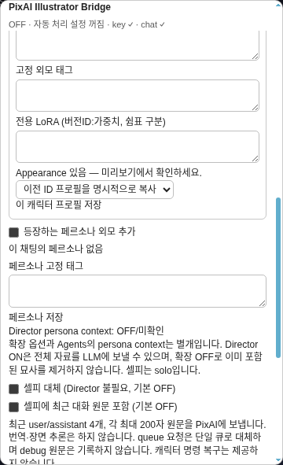
*페르소나 외모는 기본 OFF입니다.*

| 항목 | 설명 |
|---|---|
| **등장하는 페르소나 외모 추가** | 체크하는 즉시 저장됩니다(로그 `settings: 옵션 저장됨`). ON이고 **Director가 `PIXAI_PERSONA: true`를 낸 자동 삽화에만** 내 페르소나 외모를 넣습니다. **셀피에는 넣지 않습니다**(셀피는 solo). |
| 페르소나 ID 줄 | 현재 채팅의 페르소나 ID, 없으면 `이 채팅의 페르소나 없음` |
| **페르소나 고정 태그** | 페르소나 외모 태그. 비어 있으면 페르소나의 appearance 칸을 읽어 씁니다. |
| **페르소나 저장** | 성공 시 `persona: 프로필 저장됨` |
| `Director persona context: …` | `ON` / `OFF/미확인` / `Director 중복/없음 — Agents에서 확인하세요. 수동 셀피는 사용 가능합니다.` |

> 확장의 페르소나 옵션과 Agents 쪽 Director의 persona context는 **별개**입니다. 동봉 Director는 persona context가 OFF입니다. Agents에서 그걸 켜면 **페르소나 전체 자료가 선택한 LLM으로** 갈 수 있고, 확장 옵션을 꺼도 그 전송을 되돌리지 못합니다.

### 5-7. 셀피 관련 체크박스

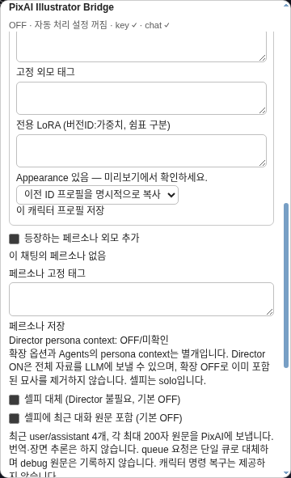
*두 체크박스 모두 누르는 즉시 저장됩니다.*

| 항목 | 설명 |
|---|---|
| **셀피 대체 (Director 불필요, 기본 OFF)** | ON이면 **Conversation 모드** 채팅의 Marinara 셀피 요청을 PixAI로 대신 처리합니다. 실제 생성할 때마다 비용 확인창이 뜹니다. 결과는 갤러리에만 저장(메시지 미첨부). Conversation 모드가 아니거나 참가 캐릭터가 아니면 `Conversation 참가 캐릭터를 선택하세요.` 실패한 요청을 원래 Marinara 이미지 연결로 다시 보내지 않습니다. |
| **셀피에 최근 대화 원문 포함 (기본 OFF)** | ON이면 셀피 프롬프트에 최근 대화를 **원문 그대로** 덧붙여 PixAI에 보냅니다(아래). |

**최근 대화 옵션이 PixAI로 보내는 것(정확히):**

> **OFF가 대화 관련 자료의 전송을 전부 막는 것은 아닙니다.** 0.2.0은 Marinara 셀피 요청의 `context`를 옵션과 별개로 프롬프트에 넣습니다(최대 200자, 예산이 있으면 원문 포함). 이 경로는 옵션 OFF + `previewOnly` 요청으로 재현했습니다. 아래 최근 4개 조회를 끄는 것과 요청 자체의 context를 제외하는 것은 다릅니다. 0.2.1 수정 후보입니다.

- 대상: **셀피와 무료 미리보기만**. 자동 삽화에는 쓰지 않습니다.
- 셀피 요청 시각까지의 메시지 중 숨기지 않은 **user/assistant 메시지 최근 4개**.
- 각 메시지의 **앞부분 최대 200자**를 번역·요약 없이 `[최근 대화 원문 발췌: <원문>]` 형태로 프롬프트에 붙입니다.
- 2,000자 예산이 모자라면 오래된 것부터 빠집니다.

셀피 기본 구도 태그는 `solo, selfie, upper body, looking at viewer`입니다.

### 5-8. 무료 미리보기

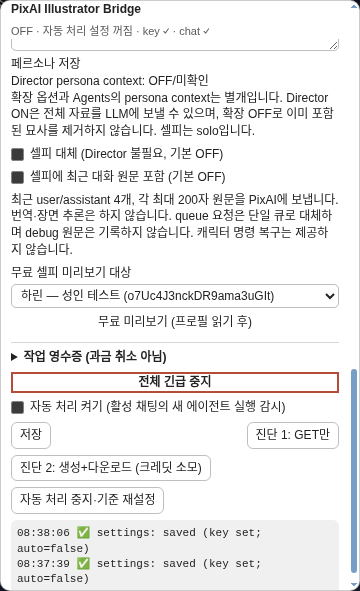
***현재 채팅 프로필 읽기**를 누른 뒤에야 `이름 (ID)` 선택지가 생깁니다. 그림은 선택된 항목이며, 칸을 누르면 참가자 목록이 열립니다.*

1. **무료 셀피 미리보기 대상**에서 캐릭터를 고릅니다(비어 있으면 5-6의 **현재 채팅 프로필 읽기**부터).
2. **무료 미리보기 (프로필 읽기 후)**를 누릅니다.
3. 아래 상자에 결과가 나옵니다.

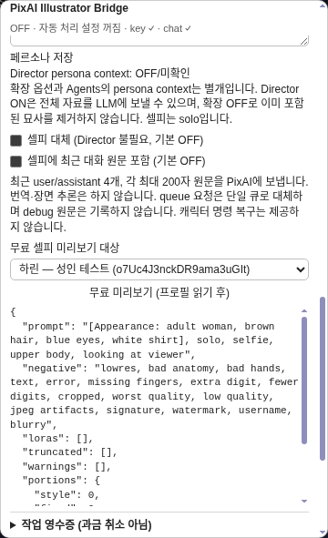
*PixAI에 보낼 내용을 그대로 보여 줍니다. 크레딧 0.*

| 결과 항목 | 뜻 |
|---|---|
| `prompt` | 실제로 보낼 프롬프트 전체 |
| `negative` | 보낼 negative |
| `loras` | 합쳐진 LoRA 목록 |
| `style` | 보낼 PixAI style(Tsubaki가 아니면 없음) |
| `truncated` | 자리가 모자라 잘리거나 빠진 부분(`장면 뒤쪽`, `appearance`, `description`, `최근 대화`) |
| `warnings` | 외모 정보 없음, style 미전송, LoRA 우선순위 등 경고 |
| `portions` | 부분별 글자 수(style=화풍 태그, fixed=고정 외모, scene=장면, supplement=카드 외모, context=최근 대화) |

- 미리보기는 **셀피용** 프롬프트입니다(셀피 기본 구도 + 선택 캐릭터). 자동 삽화 프롬프트는 Director가 쓰는 장면에 따라 달라서 미리 볼 수 없습니다. 다만 화풍·고정 외모·LoRA 조합은 같은 규칙으로 확인됩니다.
- PixAI에는 아무것도 보내지 않고 Marinara 서버에서 채팅·카드(최근 대화 ON이면 메시지 목록)만 읽습니다.
- 미리본 뒤 설정을 바꾸고 Marinara에서 그 미리보기 프롬프트로 셀피를 요청하면 `설정 변경 — 무료 미리보기를 다시 여세요.`로 거부됩니다. 다시 미리보세요.

**프롬프트가 조립되는 순서**(태그 중복은 자동 제거):

`[화풍 태그(앞)]` → 고정 외모 태그(캐릭터, 페르소나) → `[Appearance/Description: …]` → (셀피면) `solo, selfie, upper body, looking at viewer` → 장면 → `[최근 대화 원문 발췌: …]` → `[화풍 태그(뒤)]`

**2,000자 한도:** 프롬프트는 최대 2,000자(UTF-16 기준)입니다. 화풍 태그·고정 외모·셀피 구도는 먼저 자리를 잡고 **절대 잘리지 않으며**, 이것만으로 넘치면 `화풍·고정 외모·최소 구도가 2,000자 예산을 초과합니다.`로 생성이 막힙니다. 남은 자리는 장면 → 카드 외모 → 최근 대화 순으로 채웁니다. negative는 따로 2,000자입니다.

### 5-9. 작업 영수증 (접힌 섹션)

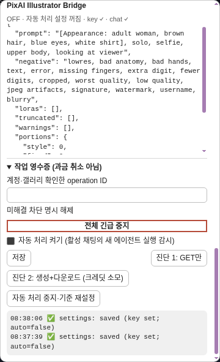
*제목에 적힌 대로, 영수증은 과금 취소가 아닙니다.*

유료 작업(자동 삽화·셀피·진단 2)마다 한 줄씩 남습니다: `operationId · 상태 · task <PixAI 작업 ID> · gallery <갤러리 ID>`. operationId는 `run:…`(자동 삽화), `selfie:…`(셀피), `diagnostic:…`(진단 2)로 시작합니다. 키·프롬프트·대화는 저장하지 않습니다.

| 상태 | 뜻 | 해결됨? |
|---|---|---|
| `claimed` | 작업 자리 잡음(생성 전) | 미해결 |
| `creating` | PixAI 생성 요청 직전/중 | 미해결 |
| `taskKnown` | PixAI가 접수함(과금됐을 가능성 큼), 아직 그림 못 받음 | 미해결 |
| `downloaded` | 그림 받음, 갤러리 저장 전 | 미해결 |
| `uploaded` | 갤러리 저장됨(셀피는 다음이 complete) | 미해결 |
| `complete` | 완료(셀피·진단 2) | **해결** |
| `attached` | 메시지 첨부까지 완료(자동 삽화) | **해결** |
| `failedBeforeCreate` | 생성 요청 전에 실패 — 과금 없음 | **해결** |
| `ambiguous` | 생성 요청을 보냈는데 결과를 모름 — 과금됐을 수 있음 | 미해결 |
| `attachmentFailed` | 갤러리엔 있지만 메시지 첨부 실패 | 미해결 |

**미해결 작업이 있으면 같은 채팅(진단 2는 진단끼리)의 새 유료 작업이 막힙니다**(`미해결 작업 확인 후 명시적으로 해제하세요.`). 확장은 미해결 작업을 자동으로 다시 하거나 지우지 않습니다.

해제 방법:

1. PixAI 계정의 생성 기록과 Marinara 갤러리를 확인합니다.
2. **계정·갤러리 확인한 operation ID** 칸에 해당 줄의 operationId(예: `diagnostic:…` 전체)를 붙여 넣습니다.
3. **미해결 차단 명시 해제**를 누르고 확인창("기록 차단을 해제하면 다음 요청은 다시 과금될 수 있습니다. PixAI 계정과 갤러리를 확인했습니까?")에서 확인합니다.

해제는 실행 탭에서, 진행 중인 작업이 없을 때만 됩니다. 해제는 그 줄을 영수증에서 지우는 것이지 **환불이 아닙니다.** 완료 기록은 최대 500건까지 보관되고, 미해결이 500건이면 새 작업이 막힙니다.

### 5-10. 하단 버튼

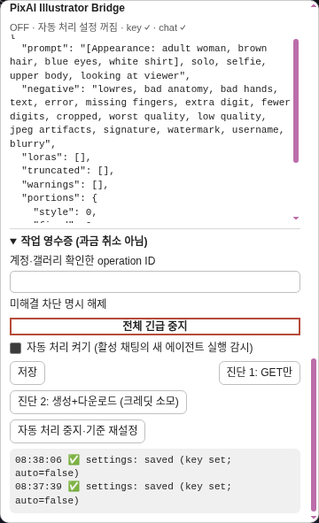
*빨간 테두리가 전체 긴급 중지.*

| 항목 | 설명 | 비용 |
|---|---|---|
| **전체 긴급 중지** | 자동 처리·셀피 대체를 끄고, 진행 중 요청을 끊고, 다른 탭에도 중지를 알립니다. 로그 `stop: 전체 중지됨 — 접수된 과금은 취소되지 않습니다. 미해결 작업 기록을 확인하세요.` | 무료 |
| **자동 처리 켜기 (활성 채팅의 새 에이전트 실행 감시)** | 체크 + **저장**해야 켜집니다. 켜면 **지금 열린 채팅**의 Director 실행을 4초마다 확인해 새 장면을 그립니다. 켜기(저장) **이전**에 있던 실행은 그리지 않습니다. | 장면마다 **유료**, 확인창 없음 |
| **저장** | 키·기억·모델·LoRA·ratio·size·mode·promptHelper·negative·자동 처리 ON/OFF를 저장. 자동 처리가 체크돼 있으면 Director가 정확히 1개인지 확인합니다. 작업 중엔 `작업 완료 후 설정을 저장하세요.` | 무료 |
| **진단 1: GET만** | PixAI 결과 조회 주소에 닿는지 확인(6장) | 무료 |
| **진단 2: 생성+다운로드 (크레딧 소모)** | 확인창 후 실제 1장 생성·다운로드. **갤러리에 저장하지 않습니다.** 프롬프트는 화풍 태그 + `solo, simple background, upper body`, 비율 1:1, 패널의 모델·전역 LoRA·size·mode 사용. 실행 탭에서만. | **유료** |
| **자동 처리 중지·기준 재설정** | 자동 삽화를 끄고, "여기부터 새 실행" 기준 시각을 지금으로 다시 잡습니다. 진행 중 작업도 다음 확인 지점에서 멈춥니다. **셀피 대체는 끄지 않습니다.** 로그 `자동 처리 중지 — 진행 중 작업도 다음 경계에서 중단됩니다. 접수된 과금은 취소되지 않으니 영수증을 확인하세요.` | 무료 |

### 5-11. 저장 방식 한눈에 보기

| 무엇을 바꿨나 | 저장하는 법 |
|---|---|
| 키, API 키 기억, 모델, LoRA, ratio/size/mode/promptHelper, negative, 자동 처리 켜기 | **저장** |
| PixAI style, 화풍 태그, 태그 위치 | **화풍 설정 저장** |
| 캐릭터 별칭·고정 외모·전용 LoRA | 카드마다 **이 캐릭터 프로필 저장** |
| 페르소나 고정 태그 | **페르소나 저장** |
| 셀피 대체, 셀피에 최근 대화 원문 포함, 등장하는 페르소나 외모 추가 | **체크하는 순간 자동 저장**(로그 `settings: 옵션 저장됨`) |

---

## 6. 로그 읽는 법

**로그 시각은 UTC이며 한국 시간보다 9시간 느립니다.** 패널 맨 아래 회색 상자가 로그입니다.

- **최신 줄이 맨 위**입니다. 위에서 아래로 시간이 거꾸로 갑니다.
- 형식: `시각 ✅/❌ 단계: 내용`. ✅=그 단계 성공, ❌=실패.
- **시각은 UTC**입니다. 한국 시간보다 **9시간 느리게** 찍힙니다(예: `07:58:25` = 한국 16:58:25).
- 최근 40줄만 보이고 새로고침하면 사라집니다.
- 키·프롬프트·PixAI 응답 본문은 로그에 남기지 않습니다. 그래서 일부 오류는 이유 없이 `처리 실패 — 키·프롬프트·원격 응답 본문은 로그하지 않습니다.`로만 나옵니다.

### 6-1. 진단 1 결과 판정

진단 1은 PixAI의 `GET /v2/task/0`(존재하지 않는 작업 조회)을 보내 **브라우저가 PixAI 응답을 읽을 수 있는지**만 봅니다.

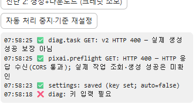
*실제 화면(아래가 먼저): 키 저장 전 `diag: 키 입력 필요` → **저장** 후 `settings: saved (key set; auto=false)` → 진단 1에서 `HTTP 400`. **이것이 정상(통과)입니다.***

| 로그 | 판정 | 뜻 |
|---|---|---|
| `pixai.preflight GET ✅ HTTP 400 — HTTP 응답 수신(CORS 통과); 실제 작업 조회·생성 성공은 미확인` 다음 `diag.task GET ✅ v2 HTTP 400 — 실제 생성 성공 보장 아님` | **통과(정상)** | 유효한 키로 실측한 결과입니다. 작업 0번은 없으니 400이 오는 게 맞습니다. 400/404/422/429/500 등도 "닿았다"는 뜻이라 생성을 막지 않습니다. |
| `pixai.preflight GET ❌ HTTP 401 — 키 확인 필요` 또는 `HTTP 403 — 키 확인 필요`, 다음 `diag ❌ 조회 사전 확인 HTTP 401 — 키 확인 필요 — 생성하지 않았습니다.` | **차단 — 키 문제** | 키가 틀렸거나 만료/권한 없음. 키를 다시 확인·저장 후 진단 1 재시도 |
| `pixai.preflight GET ❌ PixAI 결과 조회 연결을 확인하지 못했습니다 (네트워크/CORS 오류 가능). …` 다음 `diag ❌ 네트워크/CORS 오류 가능 — Network 탭 확인` (HTTP 숫자 없음) | **차단 — 연결 문제** | 인터넷·VPN·브라우저 차단 등으로 응답을 못 읽음. 이때는 키 문제인지 알 수 없습니다. |
| `diag ❌ 키 입력 필요` | 실행 안 함 | 키를 입력하고 **저장**을 안 눌렀음 |

진단 1 통과는 "PixAI에 닿는다"는 뜻일 뿐 **키가 유효하다거나 생성이 성공한다는 보장이 아닙니다.** 그건 진단 2로 확인합니다.

### 6-2. 진단 2 결과

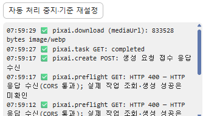
*실제 화면(아래가 먼저): preflight HTTP 400 → `pixai.create POST: 생성 요청 접수 응답 수신` → `pixai.task GET: completed` → `pixai.download (mediaUrl): 833528 bytes image/webp`.*

- 성공하면 **마지막(맨 위) 줄이 `pixai.download (mediaUrl) ✅ <숫자> bytes image/…`**입니다. 그 뒤에 갤러리 저장 줄은 **나오지 않습니다**(진단 2는 갤러리에 저장하지 않음).
- 영수증에 `diagnostic:… · complete`가 남습니다.
- 생성은 보통 수십 초 걸릴 수 있습니다. 최대 180초까지 기다리고 넘으면 `pixai.task GET ❌ timeout`.

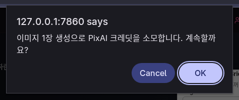
*진단 2를 누르면 이 확인창이 먼저 뜹니다. 취소하면 아무 일도 없습니다.*

### 6-3. 자주 보는 로그

| 로그 (단계: 내용) | 뜻 / 할 일 |
|---|---|
| `settings ✅ saved (key set; auto=false)` | 저장 성공. `key EMPTY`면 키가 비어 있음, `auto=true`면 자동 처리 ON |
| `settings ✅ 옵션 저장됨` | 체크박스(셀피·최근 대화·페르소나) 저장됨 |
| `settings ❌ 키 입력 필요` | 자동 처리를 켜고 저장하려는데 키가 비었음 |
| `settings ❌ 가져온 PixAI Director가 정확히 한 개 필요합니다.` | Director가 없거나 2개 이상. Agents에서 하나만 남기기 |
| `settings ❌ Web Locks 지원 localhost/HTTPS 브라우저 한 탭에서만 자동 처리할 수 있습니다.` | 실행 탭이 아님 / HTTP 주소 |
| `settings ❌ 작업 완료 후 설정을 저장하세요.` | 진행 중 작업이 있어 저장 불가. 끝나길 기다리거나 중지 버튼 사용 |
| `settings ❌ 자동 처리 복원 보류 — PixAI Director 한 개와 연결 상태를 확인하고 저장하세요.` | 새로고침 후 자동 처리 복원 실패 |
| `settings ❌ LoRA …` / `모델 ID는 …` | 5-3 LoRA·모델 규칙 위반 |
| `agent.parse ✅ SKIP / no PIXAI_PROMPT` | Director가 이번 답장은 그리지 않기로 함(정상, 무료) |
| `pixai.preflight GET …` | 유료 생성 직전 매번 하는 연결 확인(6-1과 같은 판정) |
| `pixai.create POST ✅ 생성 요청 접수 응답 수신` | PixAI가 생성 요청을 받음 = **과금 시작** |
| `pixai.create POST ❌ HTTP 4xx/5xx` | 생성 요청 거부(잔액·모델·LoRA·모드 등). 숫자로 원인을 짐작 |
| `pixai.task GET ✅ v2 HTTP 404 → v1 폴백` | 결과 조회 경로를 예전 주소로 바꿈(정상 동작) |
| `pixai.task GET ✅ completed` | 생성 완료 |
| `pixai.task GET ❌ 작업 실패 또는 취소` / `timeout` | PixAI 쪽 실패 / 180초 초과 |
| `pixai.download (mediaUrl) ✅ N bytes image/webp` | 그림 받음 |
| `pixai.download (…) ❌ … v1 media 폴백은 도메인 Origin에서 …` | 그림 받기 실패. 도메인 주소 접속에서 막힐 수 있음 |
| `gallery.upload ✅ uploaded` | 갤러리 저장 |
| `message.attach ✅ 메시지 첨부 완료` | 자동 삽화가 답장에 붙음 |
| `operation ✅ 갤러리 저장 완료 — …` | 자동 삽화·셀피 작업 끝 |
| `operation ❌ 이번 요청 생성 안 함 — <이유>` | 생성 요청 전에 멈춤 → **과금 없음** |
| `operation ❌ 접수 여부/완료 불명 — 자동 재생성 없음. 작업 영수증과 계정을 확인하세요. — <이유>` | 과금됐을 수 있음. PixAI 계정·갤러리 확인 |
| `run ❌ <이유>` | 자동 삽화 1건 실패(그 답장은 다시 시도하지 않음) |
| `… 중지/시간 초과 — 과금 여부 확인 전 재시도 금지` | 요청이 끊기거나 30초 넘게 응답 없음. 영수증 먼저 확인 |
| `… 네트워크/CORS 오류 가능 — Network 탭 확인` | 연결 문제 |
| `… 처리 실패 — 키·프롬프트·원격 응답 본문은 로그하지 않습니다.` | 확장이 이유를 분류하지 못한 실패(대표 예: 미리보기 대상 미선택) |
| `stop ✅ 전체 중지됨 — …` | 긴급 중지/키 삭제 완료 |
| `stop ❌ 현재 탭 중지됨 / 서버 저장 실패 — …` | 이 탭만 멈춤. 다른 탭 닫고 저장 상태 확인 |
| `ledger ❌ 영수증 갱신 실패 — 새 생성 전에 계정과 갤러리를 확인하세요.` | 영수증 기록 실패 |
| `selfie ❌ 응답 계약 불일치 — 이 세션의 셀피 대체를 껐습니다. …` | Marinara 버전 차이로 셀피 대체가 이번 세션 동안 꺼짐. **다음 셀피는 원래 Marinara 이미지 연결로 가고 그쪽 비용이 들 수 있음** |
| `position ❌ 위치 저장 실패 — …` | 버튼 위치만 저장 실패(과금과 무관) |

---

## 7. 비용과 안전

### 7-1. "끄기(체크 해제)"와 "중지 버튼"은 다릅니다

| | 체크 해제 (OFF) | 중지 버튼 |
|---|---|---|
| 해당 | **셀피 대체** 체크 해제(즉시 저장), **자동 처리 켜기** 체크 해제 + **저장** | **전체 긴급 중지**, **저장된 키 삭제**, **자동 처리 중지·기준 재설정**, 확장 비활성화 |
| 아직 생성 요청 전인 작업 | 막음 | 막음 |
| **이미 PixAI에 접수된(과금된) 작업** | **끝까지 진행해 갤러리까지 저장**(돈 낸 그림을 버리지 않음) | **후처리(다운로드·저장·첨부)도 중단**하고 미해결 기록을 남김 |
| 다른 탭 | 영향 없음 | 다른 탭에도 중지 전달 |
| 환불 | 없음 | **없음** — 이미 접수된 작업은 취소·환불되지 않습니다 |

- 자동 처리가 작업 중일 때는 **저장**이 막히므로, 급히 끄려면 **자동 처리 중지·기준 재설정**이나 **전체 긴급 중지**를 쓰세요.
- **최근 대화/페르소나 OFF**는 다음 작업부터 적용되고, 이미 보낸 자료를 되돌리지 않습니다.

### 7-2. 중복 과금을 막는 장치와 주의

- **다시 누르면 새 비용입니다.** 완료된 셀피·진단 2를 다시 요청하면 또 1장 과금됩니다.
- **결과가 불명확한 생성 요청(`ambiguous`)은 자동으로 다시 보내지 않습니다.** 대신 영수증에 미해결로 남기고 같은 채팅의 새 작업을 막습니다. 계정을 확인한 뒤 직접 해제하세요(5-9).
- 자동 삽화는 PixAI 호출 **전에** 실행 ID를 "처리함"으로 기록합니다. 그래서 새로고침·오류가 나도 같은 답장을 두 번 그리지 않지만, **실패한 답장도 다시 그리지 않습니다.**
- 셀피 대체가 요청을 맡은 뒤 실패하면 **원래 Marinara 이미지 연결로 다시 보내지 않습니다**(이중 과금 방지). Marinara에는 `… — 원본 재전송 없음. 작업 기록에서 미접수/접수 불명을 확인하세요.` 오류가 갑니다.
- 같은 채팅에서 다른 이미지 작업이 진행 중이면 셀피는 `같은 채팅 이미지 작업 완료 후 요청하세요.`로 거부됩니다.
- 서로 다른 기기·브라우저에서 동시에 쓰면 이 보호가 통하지 않습니다.

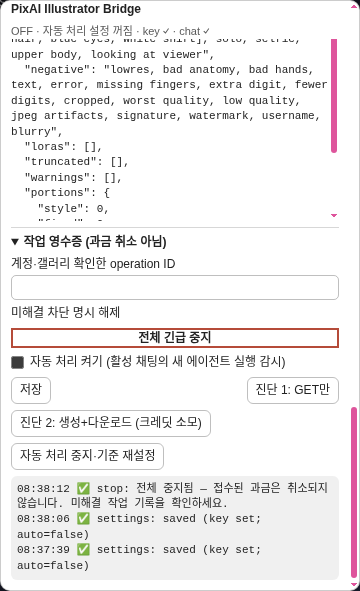
*전체 긴급 중지 후: 상태줄 OFF, 셀피 대체·자동 처리 체크 해제, `stop: 전체 중지됨 …`.*

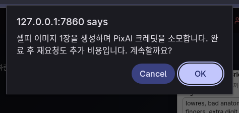
*셀피 대체는 생성할 때마다 이 확인창이 뜹니다. 자동 삽화에는 확인창이 없습니다.*

**자동 삽화 완성 화면(촬영 목록 24번)은 미촬영입니다.** 이 경로에는 비용 확인창이 없어 "확인창까지만 촬영 후 취소"할 수 없습니다. 실제 PixAI 호출 금지 조건을 지켰으며 성공 화면을 합성하지 않았습니다. 코드상 자동 삽화는 대상 답장에 첨부되고 갤러리에도 남습니다. 실생성·새로고침 후 유지 확인은 별도 비용 승인 후 진행해야 합니다.

### 7-3. 개인정보 — 기기 밖으로 나가는 것

| 자료 | 어디로 가나 |
|---|---|
| 프롬프트·negative | **PixAI**로 전송. 결과 프롬프트는 Marinara 갤러리·삽화 첨부에도 저장 |
| 카드 외모(Appearance/Description 원문 일부) | 프롬프트에 포함되면 **PixAI**로 전송 |
| 최근 대화 원문(옵션 ON, 셀피만) | **PixAI**로 전송(최근 4개, 각 200자) |
| Marinara 셀피 요청의 `context` | **최근 대화 옵션 OFF여도** 프롬프트 예산이 있으면 앞부분 최대 200자를 원문으로 **PixAI**에 전송. 0.2.0 코드와 무과금 preview QA에서 확인 |
| 페르소나 외모(옵션 ON + Director가 등장 표시) | **PixAI**로 전송 |
| Director가 읽는 채팅·캐릭터(설정 시 페르소나) | **선택한 AI 연결(LLM)**로 전송 |
| 그림 | PixAI/CDN → Marinara 갤러리(삽화는 메시지 첨부) |
| API 키·프로필·화풍·설정·영수증 | **Marinara 서버의 확장 저장소에 평문 저장**. 서버 데이터 폴더·백업에도 남을 수 있음 |

- 서버에 접속할 수 있는 사람·프로그램은 확장 저장소를 읽어 **키를 볼 수 있습니다.** 공용 서버라면 키 기억을 끄세요.
- 브라우저 데이터를 지워도 서버의 키는 지워지지 않습니다. **저장된 키 삭제**를 쓰세요.
- 셀피 요청에 붙은 Marinara 관리·보안 헤더는 PixAI·로그·영수증으로 보내지 않습니다.
- 확장이 카드·대화 내용을 웹페이지로 실행하거나 주소로 열지 않습니다.

---

## 8. 문제 해결 (FAQ)

| 증상 | 원인 | 해결 |
|---|---|---|
| **무료 미리보기**를 누르면 `preview: 미리보기 실패 — 처리 실패 — …`만 나옴 | **무료 셀피 미리보기 대상** 칸이 비어 있음(프로필 읽기를 안 함) 또는 열린 채팅이 없음. **실사용에서 실제로 발생한 문제**이며 오류 문구가 이유를 알려 주지 않는 알려진 문제(0.2.1에서 수정 예정) | 채팅을 열고 **캐릭터·페르소나 프로필**을 펼쳐 **현재 채팅 프로필 읽기** → 대상 선택 → 다시 미리보기 |
| 대상 칸이 프로필 읽기 후에도 비어 있음 / `profiles: 프로필 조회 실패 …` | 열린 채팅 없음, 또는 카드 조회 실패 | 채팅을 연 상태에서 다시 시도. 상태줄 `chat ✓` 확인 |
| 진단 1이 `diag: 키 입력 필요` | 키를 입력만 하고 **저장**을 안 누름 | **저장** 후 다시 |
| 진단 1·2 버튼을 눌러도 아무 반응 없음 | 다른 작업이 진행 중이면 조용히 무시됨 | 작업이 끝난 뒤 다시 |
| `HTTP 401` / `HTTP 403 — 키 확인 필요` | 키가 틀림·만료·권한 없음 | PixAI에서 키 확인 → 입력 → **저장** → 진단 1 |
| HTTP 숫자 없이 `네트워크/CORS 오류 가능` | 인터넷·VPN·브라우저가 PixAI 연결을 막음 | 연결 확인 후 진단 1부터 다시. 키 문제로 단정하지 마세요 |
| 진단 1이 `HTTP 400` | **정상**입니다 | 그대로 다음 단계 |
| 자동 처리 켜기 체크했는데 상태줄이 `OFF · 자동 처리 설정 꺼짐` | 체크만 하고 **저장**을 안 누름 | **체크 + 저장**까지 해야 켜짐. 작업 중 저장이 막히면 끄기에는 **자동 처리 중지·기준 재설정** 또는 **전체 긴급 중지** 사용 |
| `가져온 PixAI Director가 정확히 한 개 필요합니다.` / `Director 중복/없음 — …` | Director JSON을 두 번 가져와 2개가 됐거나, 안 가져옴 | Agents에서 `PixAI Director`를 정확히 1개만 남기고 **저장** |
| 자동 처리 ON인데 그림이 안 생김 | 채팅에 Director를 안 붙임 / Director가 `SKIP` / 켜기 전에 생긴 답장 / 다른 채팅을 보고 있음 | Chat Settings › Agents › Custom Agents에서 Director 추가. 로그 `agent.parse ✅ SKIP`이면 정상. 자동 처리는 **지금 열린 채팅**만 봅니다 |
| 실패한 답장이 다시 그려지지 않음 | 중복 과금 방지 설계 | 원하면 셀피 등 다른 경로로 새로 요청(새 비용) |
| 미리보기 경고 `캐릭터 이름 미해결 — …` | Director가 쓴 이름이 카드 이름·별칭과 정확히 하나로 맞지 않음(동명이인, 오타, 표기 차이) | 카드의 **별칭**에 Director가 쓰는 이름을 추가하고 **이 캐릭터 프로필 저장**. 동명이인은 별칭을 서로 다르게 |
| 캐릭터를 다시 가져온 뒤 프로필이 안 먹음 | 캐릭터 ID가 바뀜 | 카드에서 **이전 ID 프로필을 명시적으로 복사** → **이 캐릭터 프로필 저장** |
| `LoRA는 최대 5개입니다.` / `병합 LoRA 5개 초과 — …` | 전역 + 캐릭터 전용 LoRA 합계가 5개 초과 | 전역 또는 캐릭터 LoRA를 줄이기 |
| `캐릭터 LoRA 가중치 충돌` | 한 장면의 두 캐릭터가 같은 LoRA를 다른 가중치로 씀 | 가중치를 맞추거나 한쪽에서 빼기 |
| 저장 시 `LoRA ID는 양의 정수 문자열이어야 합니다.` | 빈 LoRA 행이 남아 있거나 숫자가 아닌 ID | 빈 행 **삭제**, 버전 ID(숫자)만 입력 |
| `화풍·고정 외모·최소 구도가 2,000자 예산을 초과합니다.` | 화풍 태그 + 고정 외모(+custom style)가 너무 김 | 화풍 태그·고정 외모를 줄이기. custom style도 길이를 차지함 |
| 미리보기 `truncated`에 `장면 뒤쪽`·`description` 등 | 2,000자 안에 다 못 들어가 일부가 빠짐 | 고정 외모를 짧게, Description 대신 카드 Appearance 칸 사용 |
| `확인된 Tsubaki 모델이 아니므로 style은 전송하지 않습니다.` | Tsubaki.2 외 모델에서 PixAI style 선택 | 정상. 화풍 태그는 그대로 적용됨 |
| `미해결 작업 확인 후 명시적으로 해제하세요.` | 같은 채팅(또는 이전 진단 2)에 미해결 영수증이 있음 | 계정·갤러리 확인 → **미해결 차단 명시 해제**(5-9) |
| 자동 삽화가 갤러리엔 있는데 답장엔 안 붙음 (`attachmentFailed`, `대상 swipe 변경 — 갤러리만 보존합니다.`) | 생성 중 답장을 swipe/재생성해서 대상이 바뀜 | 갤러리에서 그림 확인. 그 채팅을 계속 쓰려면 영수증 해제 |
| `설정은 실행 탭에서 저장하세요. …` | 다른 탭이 실행 탭 | 다른 Marinara 탭을 닫고 새로고침 |
| `Conversation 참가 캐릭터를 선택하세요.` | 셀피 대상 채팅이 Conversation 모드가 아니거나 참가자가 아님 | Conversation 모드 채팅에서 사용 |
| `설정 변경 — 무료 미리보기를 다시 여세요.` | 미리본 뒤 설정이 바뀜 | 미리보기를 다시 열고 요청 |
| `selfie ❌ 응답 계약 불일치 — …` | Marinara 버전 차이 | 새로고침 후 재시도. 계속되면 셀피 대체를 끄고 보고. 그 사이 셀피는 원래 연결 비용이 들 수 있음 |
| `저장소 … 오류` / `저장소 버전 충돌 — 구버전 탭을 닫으세요.` | 0.1.x 탭이 같이 열려 있음, 또는 HTTP 주소 | 구버전 탭 모두 닫기, localhost/HTTPS로 접속 |
| 🎨 버튼이나 패널이 화면 밖/안 보임 | 위치 저장 문제 | 패널의 **위치 초기화**. 버튼은 끌어서 옮길 수 있음 |

---

## 9. 알려진 제한

- 실제 PixAI 생성은 실사용 피드백으로 확인 중입니다. **iPhone Safari·원격 HTTPS 환경에서의 실패 동작과 셀피·자동 삽화의 갤러리 저장·새로고침 유지 여부는 아직 확인 중입니다.** 데스크톱/390px QA 촬영을 해당 실기기 검증으로 해석하지 마세요.
- **최근 대화 OFF여도 요청 `context` 최대 200자 포함** — 5-7·7-3 참고. 개인정보 관점의 0.2.1 수정 후보이며 이 문서 작업에서 제품 코드는 변경하지 않았습니다.
- **무료 미리보기 대상 미선택 시 오류가 `처리 실패`로만 나옵니다.** 0.2.1에서 고칠 예정입니다. 그 전에는 **프로필 읽기 먼저**.
- 0.2.1로 넘긴 항목: 다른 탭에서 막혔을 때(409) 안내 세분화, 카드 조회 실패 시 외모 보충만 건너뛰고 진행하는 기능. 지금은 보수적으로 오류로 끝냅니다.
- **제공하지 않음:** 캐릭터 명령(SSE) 셀피의 오류 복구, Noodle·아바타·비디오·참조 이미지.
- **한 기기·한 브라우저·한 주소만 지원.** 여러 기기 동시 사용 시 중복 과금을 막지 못합니다. 0.1.x와 섞어 쓰는 것도 완전히 감지하지 못합니다.
- 자동 삽화는 서버와 기기의 **시계가 맞아야** 하며 열린 채팅을 4초마다 확인합니다. 오래된 실행은 다시 처리하지 않습니다.
- 생성 중 대상 답장의 swipe가 바뀌면 메시지 첨부 없이 갤러리에만 남습니다.
- 다른 작성자와 동시에 메시지 첨부를 고치면 한쪽이 덮일 수 있습니다(서버 쪽 원자적 갱신 없음).
- 이미지는 허용된 HTTPS 주소·이미지 형식·20 MiB 이하만 받습니다. 예전 v1 media 경로는 도메인 주소 접속에서 막힐 수 있습니다.
- 2,000자 자르기는 글자(코드포인트) 경계는 지키지만, 결합 이모지 같은 묶음 글자는 깨질 수 있습니다.
- PixAI style 프리셋이 PixAI 안에서 얼마나 길게 펼쳐지는지는 알 수 없습니다.
- 메시지 목록을 나눠 읽지 않고 한 번에 읽습니다(아주 긴 채팅에서 느릴 수 있음).
- 확장은 키를 다른 확장·같은 사이트의 코드·개발자 도구로부터 숨기지 못합니다(`full_page_access`).

---

## 리비전 이력

| 날짜 | 변경 |
|---|---|
| 2026-10-14 | 최초 작성 (v0.2.0 기준) |
| 2026-10-14 | QA 촬영·설치·비용·개인정보 정정 |
